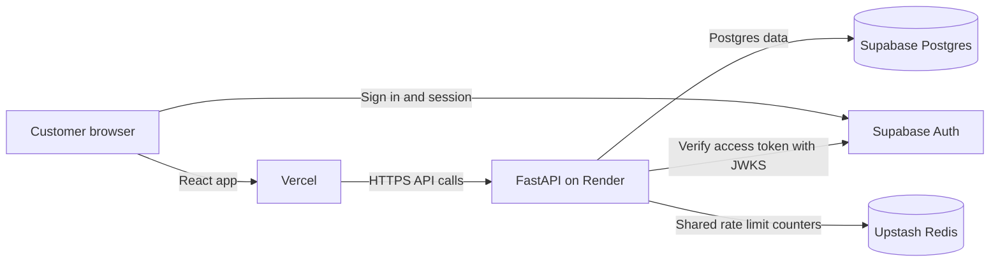

# ArtisanLoft

[](https://github.com/shreyasgowdak27/ArtisanLoft/actions/workflows/backend-fastapi-ci.yml)

A furniture storefront built with React, FastAPI, Supabase, and Redis.

## Live app

- Frontend: [artisanloft.vercel.app](https://artisanloft.vercel.app)
- API: [artisan-loft-api.onrender.com](https://artisan-loft-api.onrender.com)
- Health: [API health check](https://artisan-loft-api.onrender.com/health)

## Architecture



## Key engineering decisions

### Rate limiting runs before authentication
FastAPI checks route limits before auth dependencies on protected reads and writes.
This limits abusive traffic before it uses authentication or route resources.

### The limiter fails open
If Upstash is unavailable, the API allows the request and logs the failure.
This keeps the storefront available during a Redis outage.

### Row level security protects user data
Supabase RLS policies scope cart and order rows to the signed in user's ID.
This adds a database level ownership check alongside API authorization.

### JWTs are verified with JWKS
FastAPI checks Supabase token signatures, expiry, and the `authenticated` audience.
JWKS lets the API use Supabase's signing keys without storing user passwords.

### GitHub Actions runs backend CI
The workflow runs backend tests on pushes and pull requests to `main`.
This catches backend regressions before changes are merged.

## Run locally

### Requirements

- Python 3.12
- Node.js 18 or newer with npm
- A Supabase project

Clone the project and create local environment files:

```bash
git clone https://github.com/shreyasgowdak27/ArtisanLoft.git
cd ArtisanLoft
cp backend-fastapi/.env.example backend-fastapi/.env
cp frontend/.env.example frontend/.env.local
```

Set the Supabase project URL, anon key, and Postgres transaction pooler URL in the environment files. Set the backend `ENV=development` and the frontend `REACT_APP_API_URL=http://localhost:8000`. Keep `.env` and `.env.local` private.

### Start the backend

```bash
cd backend-fastapi
python3 -m venv .venv
source .venv/bin/activate
pip install -r requirements.txt
alembic upgrade head
python -m app.seed --confirm
uvicorn app.main:app --reload --port 8000
```

The seed command requires `--confirm`, refuses to run when `ENV` is `production` or `prod`, and upserts products by slug, so it is safe to run again.

### Start the frontend

In a second terminal from the repository root:

```bash
cd frontend
npm install
npm start
```

Open `http://localhost:3000`. The API health check is at `http://localhost:8000/health`.

## Run tests

Run the backend suite from `backend-fastapi` in a virtual environment. The development requirements install the runtime dependencies plus pytest and HTTPX.

```bash
cd backend-fastapi
python3 -m venv .venv
source .venv/bin/activate
pip install -r requirements-dev.txt
pytest
```

GitHub Actions uses the same development requirements and runs `pytest` on Python 3.12.

## Deployment

The React frontend is hosted on Vercel and the FastAPI API runs on Render. Supabase provides Postgres and Auth. Upstash Redis shares rate limit counters across API instances when `REDIS_URL` is configured. Set `ENV=production` in Render to keep local origins out of production CORS settings.
