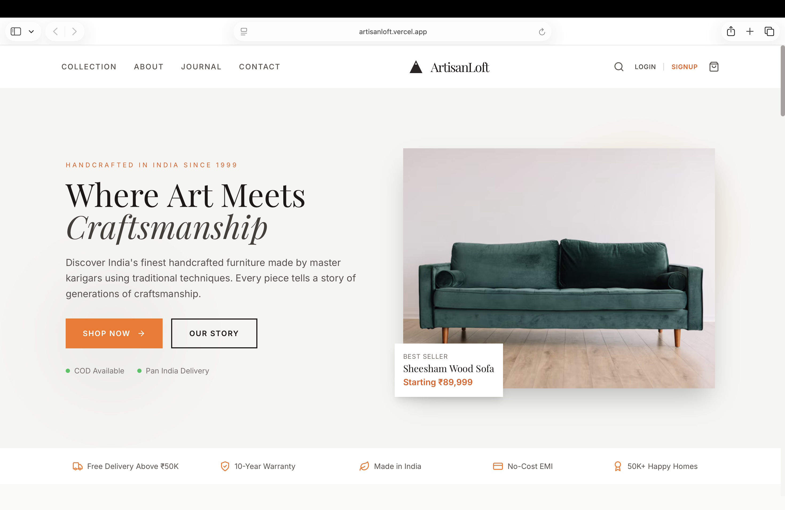
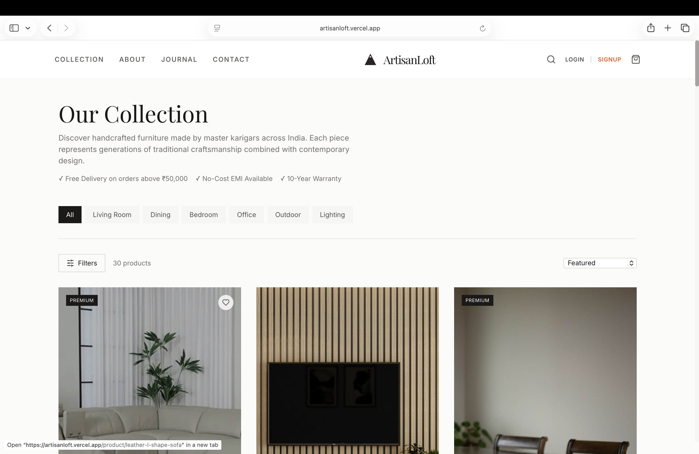
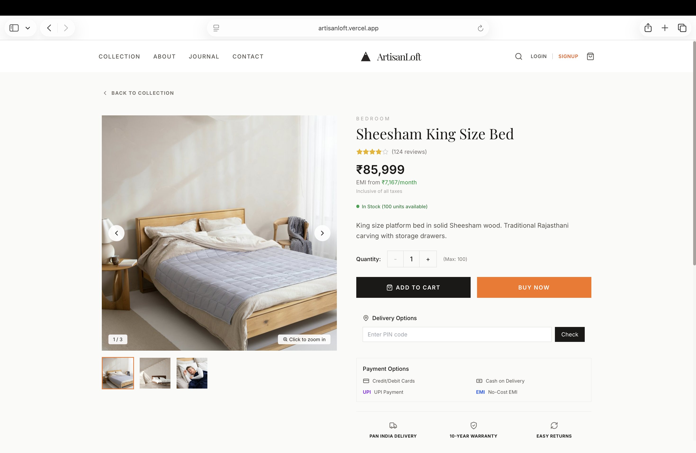
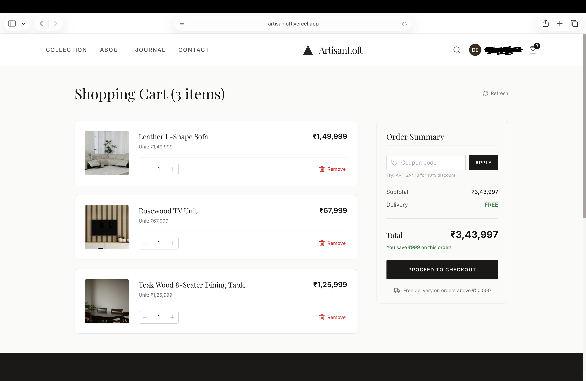
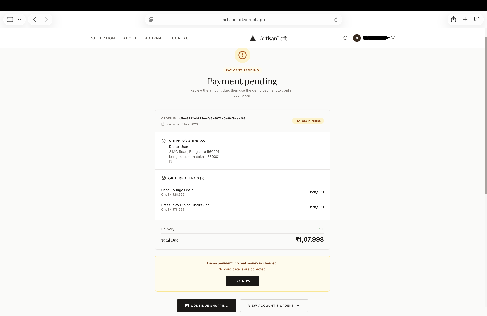
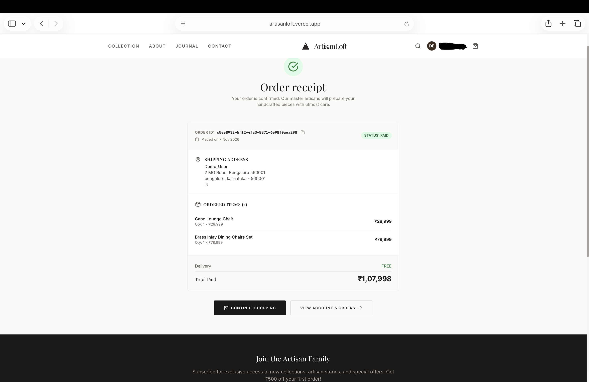
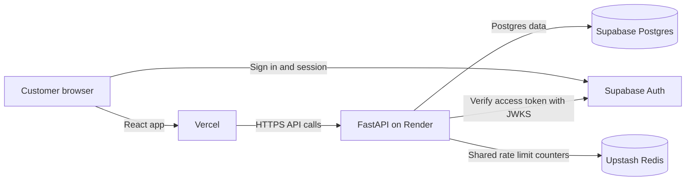

# ArtisanLoft

[](https://github.com/shreyasgowdak27/ArtisanLoft/actions/workflows/backend-fastapi-ci.yml)

A furniture storefront built with React, FastAPI, Supabase, and Redis.

## Live app

- Frontend: [artisanloft.vercel.app](https://artisanloft.vercel.app)
- API: [artisan-loft-api.onrender.com](https://artisan-loft-api.onrender.com)
- Health: [API health check](https://artisan-loft-api.onrender.com/health)

## Screenshots

| Home | Collection | Product detail |
| --- | --- | --- |
|  |  |  |

| Cart | Checkout | Receipt |
| --- | --- | --- |
| <br>Review items and order total. | <br>Confirm the order with demo payment. | <br>View the confirmed order summary. |

## Demo video

[Watch the 3-minute UI walkthrough](https://drive.google.com/file/d/1Y6hrF95Nt5zV59Rb0BYYpnY9w9mrsw9q/view?usp=sharing)

A quick tour of the live app: browsing the collection, login, cart, checkout, demo payment and receipt. The architecture and engineering decisions are documented above.

## Architecture



## Key engineering decisions

### Rate limiting runs before authentication
FastAPI checks route limits before auth dependencies on protected reads and writes.
This limits abusive traffic before it uses authentication or route resources.

### The limiter fails open
If Upstash is unavailable, the API allows the request and logs the failure.
This keeps the storefront available during a Redis outage.

### Row level security policies
The migrations define owner policies for `cart_items`, `orders`, and `order_items` when requests use Supabase's `authenticated` role with the user's JWT claims. FastAPI verifies the JWT in the API, but its SQLAlchemy database sessions do not set those claims. API cart and order access therefore relies on explicit ownership checks in the service code. The README setup uses a Supabase transaction pooler URL; a shared pooler URL normally connects as the `postgres` role, which bypasses RLS. The actual deployed database role is set outside this repository. `contact_messages` has RLS enabled without policies, so roles subject to RLS cannot access its rows.

### JWTs are verified with JWKS
FastAPI checks Supabase token signatures, expiry, and the `authenticated` audience.
JWKS lets the API use Supabase's signing keys without storing user passwords.

### GitHub Actions runs backend CI
The workflow runs backend tests on pushes and pull requests to `main`.
This catches backend regressions before changes are merged.

## Run locally

### Requirements

- Python 3.12
- Node.js 18 or newer with npm
- A Supabase project

Clone the project and create local environment files:

```bash
git clone https://github.com/shreyasgowdak27/ArtisanLoft.git
cd ArtisanLoft
cp backend-fastapi/.env.example backend-fastapi/.env
cp frontend/.env.example frontend/.env.local
```

Set the backend `DATABASE_URL` to your Supabase Postgres transaction pooler URL and set `JWT_SECRET` to a random value of at least 32 characters. Set `SUPABASE_URL`, `SUPABASE_ANON_KEY`, and `SUPABASE_SERVICE_ROLE_KEY` from your Supabase project. For the frontend, set `REACT_APP_SUPABASE_URL`, `REACT_APP_SUPABASE_ANON_KEY`, and `REACT_APP_API_URL=http://localhost:8000`. `REDIS_URL` is optional for local development. Keep `.env` and `.env.local` private.

### Start the backend

```bash
cd backend-fastapi
python3 -m venv .venv
source .venv/bin/activate
pip install -r requirements.txt
alembic upgrade head
python -m app.seed --confirm
uvicorn app.main:app --reload --port 8000
```

The seed command requires `--confirm`, refuses to run when `ENV` is `production` or `prod`, and upserts products by slug, so it is safe to run again.

### Start the frontend

In a second terminal from the repository root:

```bash
cd frontend
npm install
npm start
```

Open `http://localhost:3000`. The API health check is at `http://localhost:8000/health`.

## Run tests

Run the backend suite from `backend-fastapi` in a virtual environment. The development requirements install the runtime dependencies plus pytest and HTTPX.

```bash
cd backend-fastapi
python3 -m venv .venv
source .venv/bin/activate
pip install -r requirements-dev.txt
pytest
```

GitHub Actions uses the same development requirements and runs `pytest` on Python 3.12.

## API routes

- Products: `GET /api/v1/products` and `GET /api/v1/products/{slug}`
- Cart: `GET /api/v1/cart`, `POST /api/v1/cart/items`, `PATCH /api/v1/cart/items/{product_id}`, and `DELETE /api/v1/cart/items/{product_id}`
- Orders: `POST /api/v1/orders`, `GET /api/v1/orders`, `GET /api/v1/orders/{order_id}`, and `POST /api/v1/orders/{order_id}/pay`
- Contact: `POST /api/v1/contact`
- Current user: `GET /me`, `GET /api/v1/me`, and `GET /api/auth/me`
- Health: `GET /health` and `GET /health/ready`

## Deployment

The React frontend is hosted on Vercel and the FastAPI API runs on Render. Supabase provides Postgres and Auth. Upstash Redis shares rate limit counters across API instances when `REDIS_URL` is configured. Set `ENV=production` in Render to keep local origins out of production CORS settings.
